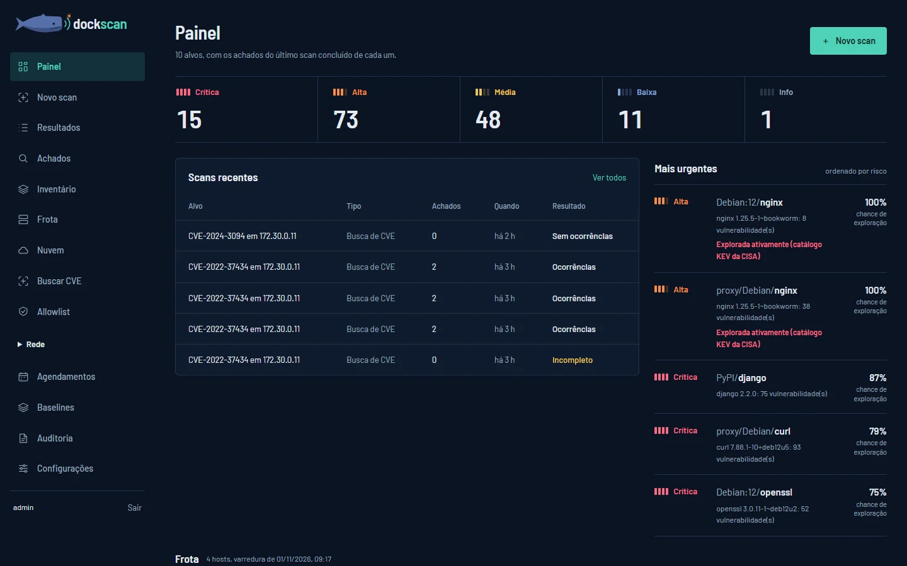
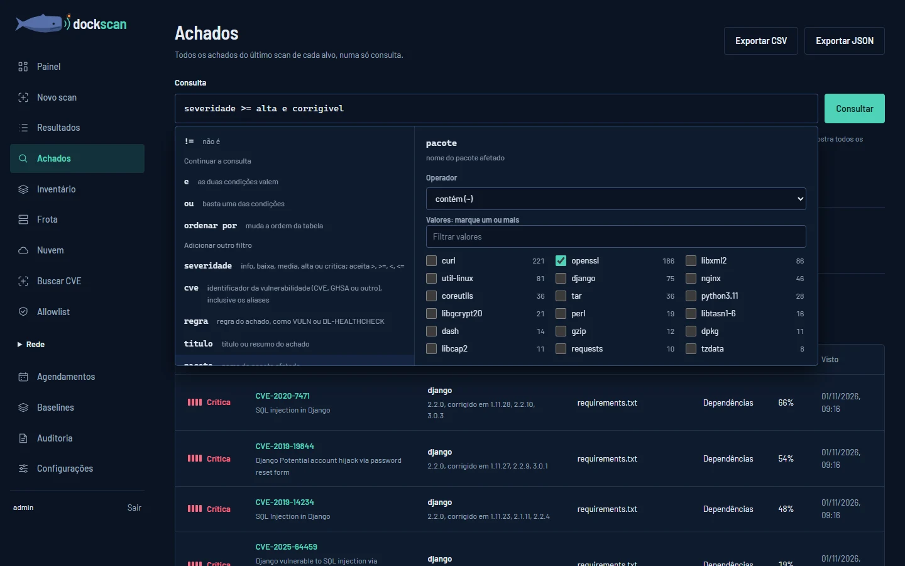
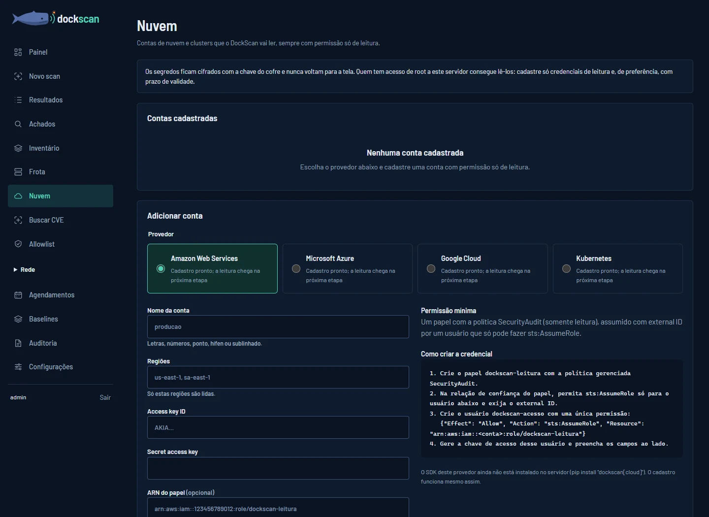

# Manual do DockScan

Manual de uso do **DockScan**, um scanner de segurança para containers Docker, máquinas Linux e redes.
O DockScan é uma ferramenta em desenvolvimento: telas e nomes podem mudar entre versões.

**[Abrir o manual](https://knxbrenno.github.io/DockScan-manual/)**



## O que é o DockScan

O DockScan encontra vulnerabilidades e configurações arriscadas no que roda containers. Ele analisa
máquinas por SSH, sem instalar agente (pacotes do sistema, containers, configuração de SSH, sudo e Docker),
imagens, Dockerfiles, dependências e redes. Cada vulnerabilidade é cruzada com o OSV e priorizada com o
catálogo KEV da CISA (exploração ativa) e o EPSS (chance de exploração).

Tudo isso fica numa interface web própria: painel, achados de todas as fontes numa consulta parecida com
SQL, comparação entre scans, inventário, agendamentos e relatórios em HTML, JSON, SARIF e SBOM.

## O que o manual cobre

| Capítulo | Para quê |
|---|---|
| Seu primeiro scan | Analisar o sistema e os containers de uma máquina pelo IP |
| Entenda os resultados | Ler severidade, localização e recomendação; a diferença entre Passou, Falhou e Erro na análise |
| Consulte os achados | Juntar todos os achados e filtrar com uma consulta como `severidade >= alta e corrigivel` |
| Acompanhe correções | Comparar dois scans e ver o que é novo, o que persiste e o que foi corrigido |
| Analise sua frota | Inventário de máquinas, cofre de credenciais SSH e busca de uma CVE ao vivo |
| Explore a rede | Portas, serviços, APIs do Docker expostas, registries e certificados TLS |
| Conecte a nuvem | Cadastro de contas da AWS, do Azure, do Google Cloud e de clusters Kubernetes, só com leitura |
| Agende análises | Repetir uma análise em intervalos definidos |
| Exporte relatórios | Escolher o formato certo para leitura, automação ou inventário de componentes |

<p>
  
  
</p>

## Em desenvolvimento

Chegou há pouco: a tela de Achados com consulta e sugestões, o cadastro de contas de nuvem, nomes de
resultado mais claros e a interface toda em português.

Próximas etapas: estado de cada achado pelo histórico (novo, ativo, corrigido, reapareceu), triagem com
prazo, tags e visões salvas, leitura da nuvem começando pela AWS, integração com Jira e notificações, e
suporte a pacotes RPM nas máquinas. O capítulo "Em desenvolvimento" do manual traz a lista completa.

## Sobre este repositório

- Aqui fica só o site do manual. É uma página estática (HTML, CSS e JavaScript), sem dependências nem
  etapa de build: para ler sem internet, abra `index.html` no navegador.
- O site é publicado pelo GitHub Pages a partir da branch `main`.
- O manual tem tema claro e escuro, busca por capítulo e uma versão para salvar em PDF.

```text
index.html       o manual
manual.css       estilos, tema claro e escuro e impressão
manual.js        abas, busca, índice e cópia de comandos
tema.js          preferência de tema
assets/          marca, fonte Barlow e as telas do laboratório
```

## Licenças e créditos de terceiros

- A fonte Barlow segue a SIL Open Font License, em [`assets/fonts/OFL.txt`](assets/fonts/OFL.txt).
- As telas em `assets/prints/` vêm do laboratório do DockScan, com dados de demonstração.
